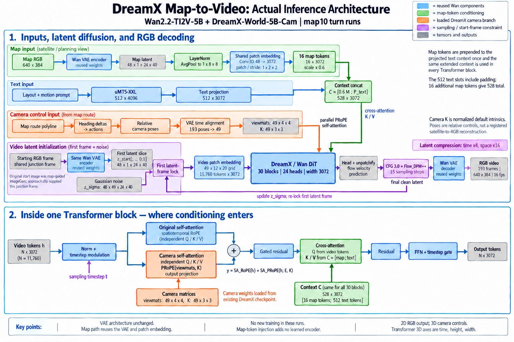

# map2world4090

Map-guided RGB video generation on RTX 4090 using **Wan2.2-TI2V-5B + DreamX-World-5B-Cam**.



This repository packages the working map10 left/right-turn pipeline: source code, the exact shared junction input image, map image, route controls, prompts, measured run summaries and video previews. It produces **2D RGB video conditioned on 3D camera poses**.

## Results

- [Left turn preview](demo/left_turn.mp4)
- [Right turn preview](demo/right_turn.mp4)
- [Architecture and implementation details](docs/ARCHITECTURE.md)

The previews are 17.0625 seconds at 640×384 / 16 fps: 5.0625 seconds of reused approach footage followed by a newly generated 193-frame turn segment, dropping the duplicated boundary frame.

Each new 12.0625-second turn segment used 15 Flow_DPM++ steps, CFG 3.0, bf16 and one RTX 4090. Denoising took 74.6 seconds; fresh-process end-to-end execution took approximately 202 seconds. This is not real-time 24-fps generation.

## Core method

1. A map-guided initial image was generated with ImageGen; an approach clip supplied the exact shared junction frame included here.
2. The same Wan VAE encodes the map into 48-channel latents. LayerNorm, pooling to 8×8 and the reused DiT patch embedding produce 16 map tokens of width 3072.
3. Map tokens scaled by 0.6 are prepended to the projected text context and read by cross-attention in all 30 Transformer blocks.
4. Route heading changes become relative camera matrices. The loaded DreamX checkpoint provides parallel PRoPE self-attention for camera conditioning.
5. Flow sampling runs in video latent space, preserving the first latent temporal slice. The unchanged VAE decoder produces RGB after sampling.

No new model training was performed for these runs. Starting-image pose is not geometrically registered to the satellite map; map tokens provide soft conditioning. Full-route endpoint arrival and exact building-by-building geographic identity have not been measured.

## Setup

Use a Linux CUDA environment with an RTX 4090 or another supported GPU. Install the inference dependencies:

```bash
git clone https://github.com/menyunlei/map2world4090.git
cd map2world4090
python -m pip install -r requirements.txt
```

The dependency manifest is inherited from the working DreamX project. CUDA-specific dependencies such as flash-attn must match the local PyTorch/CUDA toolchain.

Download the checkpoint assets separately and place them at:

```text
models/Wan2.2-TI2V-5B/
models/DreamX-World-5B-Cam/
```

Base assets: https://huggingface.co/Wan-AI/Wan2.2-TI2V-5B  
Camera checkpoint: https://huggingface.co/GD-ML/DreamX-World-5B-Cam

The base directory must include Wan2.2_VAE.pth, the uMT5 text encoder and tokenizer files expected by configs/wan2.2/wan_ti2v_5b.yaml. Weights and credentials are not included in this repository.

## Reproduce the turn event

```bash
python run_map10.py --direction right --gpu 0
python run_map10.py --direction left --gpu 0
```

This generates the new 12-second turn event from the supplied junction frame. It does not regenerate the approach or the original ImageGen frame. Defaults match the recorded runs: seed 42, 193 frames, 640×384, 16 fps, 15 steps, CFG 3.0, map strength 0.6 and camera speed 1.6692156929483608.

The source snapshots are copied unchanged from the working project; the portable run_map10.py entry point and publication documentation are newly added. Optional experimental branches in inference_long_video.py are outside this packaged demo.

## Contents

- inference_long_video.py and pipeline/: latent flow sampling.
- models/: VAE, text encoder, Transformer and PRoPE implementation source.
- map_injector.py: active training-free map-token encoding.
- utils/ and dist/: route/camera utilities and inference dependencies.
- examples/left and examples/right: fixed inputs, routes, camera audits and measured results.
- inputs/: supplied map and exact shared junction image.
- docs/: architecture, starting-image prompt, upstream attribution and source hashes.
- demo/: previously generated preview videos.

## Attribution and license

Based on DreamX-World by the DreamX Team and the Wan model family. The original project README is preserved in docs/DREAMX_UPSTREAM_README.md. The source license is included as LICENSE; third-party notices in individual source files, including PRoPE's MIT notice, are retained. Checkpoint assets are separately distributed and retain their own terms.


## A800 live generation

The deployed keyboard/cruise demo and server-map thumbnail chooser are preserved in [a800_live](a800_live/README.md). See its installation requirements and limitations before launching a GPU owner.
